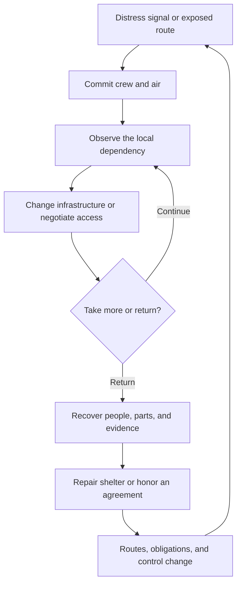

# Hollow Prison World: Game Architecture

## 1. Executive thesis

[Proposal] The prison did not fall apart. People dismantled it to survive.

The prison is both the obstacle and the tool. Each breach changes access, life support, and political control.
The player learns which walls protect people and which walls imprison them.
The central question is not "Can I open this door?" It is "Who can afford for me to open this door?"

The emotional promise is freedom through knowledge of a damaged machine.
The player gains power by changing who depends on a pump, a bridge, or a supply route.
An escape route therefore becomes a social achievement as well as a physical path.

[Scope] The supplied concept specifies a detailed, hollow prison world with damage.
It does not specify a player role, game engine, or gameplay.
This report proposes a single-player escape sandbox with a small prisoner crew.
It assesses a concept, not an existing game implementation.
All mechanics and acceptance criteria below are proposals. No playtest evidence exists yet.

### Product boundaries

- The player is a prisoner, not a prison manager.
- Damage changes useful connections. It does not exist only for spectacle.
- Progression increases knowledge, access, and obligations. It does not rely on stronger weapons.
- The campaign begins with one damaged cell block. It does not begin with a simulated planet.
- Routine maintenance resolves through a decision. It does not require repeated repair minigames.

### Main design risks

- Decorative damage creates spectacle without agency.
- Repeated cell corridors turn scale into travel time.
- Constant equipment decay turns survival into chores.
- An unrestricted collapse simulation can remove every escape route.
- Too many resources turn a human dilemma into bookkeeping.
- A complete planetary simulation consumes development effort before the core choice produces interesting consequences.

## 2. The player experience

### 2.1 The proposed role

The player is a maintenance runner, a prisoner who once worked on service crews.
The prison still recognizes that old work assignment.
The assignment grants access to some service spaces, but it also creates obligations to the guard remnant.

This role explains why the player can read service diagrams and operate infrastructure.
It does not make the player the only person who understands the prison.
Other communities possess local knowledge that no credential can replace.

The player travels with a small crew.
Crew members carry equipment, operate distant controls, and provide social access.
Their relationships determine which requests become dangerous or unacceptable.

### 2.2 The core verbs

| Verb | Player action | Consequence |
| --- | --- | --- |
| Observe | Read physical evidence, records, and distant signals | The map gains a dated observation |
| Traverse | Cross cells, ducts, bridges, and exposed void routes | The crew spends air and accepts exposure |
| Reconfigure | Isolate, reconnect, remove, or allocate a service | One group gains capacity while another can lose it |
| Negotiate | Exchange access, parts, evidence, or future service | A new route or agreement enters the network |
| Extract | Return with people, parts, or information | The shelter gains a new option and a new obligation |

These verbs share the same locations and state.
A service repair can also be a negotiation, a route change, and an escape preparation.

### 2.3 The central void

From a cell balcony, the player can see another district across the central void.
Its windows resemble stars. Some lights follow a daily schedule. Others flash messages.
The prison feels enormous because the player can see places that remain unreachable.

The void is therefore a source of information and desire, not only empty space.
A dark district can forecast a supply problem.
A new signal can reveal survivors before a route reaches them.
A market can become visible on a broken bridge before the player can trade there.

The central void contains no breathable atmosphere.
Local artificial gravity supports normal movement inside districts.
Traversal outside those districts uses anchors and tethers.
These are fictional rules, not claims about natural gravity inside a hollow planet.

### 2.4 Knowledge is progression

The prison knows the player identity. It does not understand its own condition.
Meal announcements continue in empty corridors.
Automated doors enforce sentences for people long dead.
A functioning lift refuses a destination because the work assignment belongs to another century.

The institution is not a sentient villain.
It applies valid instructions to a world that no longer matches its records.
The player can exploit that mismatch, but every exploit reveals another dependency.

The player map begins as an obsolete maintenance diagram.
Physical observation adds missing passages, severed utilities, and new communities.
An old record can be accurate about the original structure and wrong about its present use.
This difference creates investigation without arbitrary hidden rules.

## 3. The world and its detail

### 3.1 A history of survival

The original breach is old. Later damage has many human causes.
Prisoners removed doors and rails for shelter.
Guards sealed corridors to preserve the outer shell.
Communities cut through cell walls to reach water, crops, or one another.

Each district therefore contains a visible argument about survival.
One repair preserves a home but weakens a support.
One barricade stops a patrol but also blocks an evacuation route.
Random rubble does not replace this structural history.

### 3.2 Political geography

The guard remnant holds much of the outer shell.
It controls armored gates, official credentials, and some cargo equipment.
It still needs food, replacement parts, and labor from the interior.

Prisoner communities control much of the hollow interior.
They control workshops, improvised farms, and informal routes.
They still need sealed components, medicine, and access through guard territory.

The damaged districts between them contain the services that neither side can replace alone.
Control therefore means more than territory.
A faction can own a room while depending on a rival for its air.

### 3.3 Districts as interdependent services

The structure resembles a service dependency graph.
A district is a service boundary. Power lines and air ducts are shared dependencies.
A local fault can affect another district, but isolation limits the spread.

| Region | Visible condition | Useful service | Human obligation |
| --- | --- | --- | --- |
| Outer shell | Impact scars, armored gates, exposed reinforcement | Cargo access and eventual escape | The guards demand labor and order |
| Cell terraces | Dense cells, removed rails, improvised shelters | Recruitment and local knowledge | Residents expect protection and shared supplies |
| Stripped block | Missing doors, floor panels, and original fixtures | Salvage and open sightlines | Its residents need a replacement shelter |
| Sealed block | Closed shutters, working lights, maintenance requests | Intact equipment and archived records | Unknown occupants continue to request aid |
| Burned gardens | Dead crops, scarred guard stations, stolen lamps | Food and agricultural knowledge | Growers depend on power from rival districts |
| Hanging district | Failed supports, improvised braces, taut utility cables | A short connection across the void | Residents disagree about evacuation |
| Market span | A market on a broken bridge, cable cargo, patched shelters | Trade and messages between factions | Neutrality depends on continued access |
| Service layers | Ducts, cable bundles, pumps, inspection spaces | Covert routes and infrastructure control | Repairs can expose hidden activity |
| Command district | Fortified observation rooms and damaged archives | Security control and evidence | The archive can threaten every faction |

### 3.4 Detail has three scales

District silhouettes establish the first read.
A broken bridge must read before its loose bolts do.
Dust, rust, and rubble support that hierarchy.

Route-level damage explains movement.
Close material wear explains who used the route and what they removed.
Fracture patterns, exposed layers, patch repairs, and construction ages distinguish old damage from recent survival work.

Every district needs one recognizable silhouette and one visible service.
The player must connect that service to a community before small detail becomes relevant.

## 4. The connected gameplay loops

### 4.1 Pillars and shared resources

| Pillar | Consumes | Produces | Effect on another pillar |
| --- | --- | --- | --- |
| Exploration | Air reserves and route access | Parts and reliable observations | Parts support repairs and breaches |
| Infrastructure control | Parts and power | Safe routes or new breaches | Changed routes alter faction access |
| Faction negotiation | Evidence and favors | Shelter, crew, and access | Agreements change expedition options |
| Escape operations | Crew capacity and safe routes | Rescued people and evidence | Survivors change alliances and objectives |

The main currencies have distinct jobs:

- **Air** limits a committed expedition.
- **Parts** make a physical change possible.
- **Power** forces a choice between active services.
- **Access** combines physical routes, credentials, and social permission.
- **Evidence** reveals dependencies or changes a negotiation.
- **Obligations** make a past solution constrain a future choice.

Obligations are not a second reputation score.
They are specific promises, debts, and dependencies with named participants.

### 4.2 Time horizons

- **Micro, seconds to minutes:** Cross a damaged space, evade a patrol, isolate a leak, or escort a prisoner.
- **Meso, one session:** Select an expedition, accept a risk, return to shelter, and allocate the recovered parts.
- **Macro, several sessions:** Change district control, connect shelters, and assemble an escape route with lasting social consequences.

### 4.3 Session loop

The arrows show consequences, not menu navigation.

A recovered resource changes the next expedition.
The session therefore ends with a new possibility, not only a larger inventory.
The strongest result is a new relationship between two places that the player already understands.

## 5. Infrastructure creates political choices

### 5.1 One service model

Each critical service has a source, a route, a consumer, and an isolation control.
The same model covers air, power, water, transport, and security.
Different services create different spatial problems without requiring unrelated rule sets.

The player can perform four infrastructure actions:

- **Isolate** a section to contain danger or deny a rival.
- **Reconnect** a section to share a service or open a route.
- **Allocate** limited capacity between consumers.
- **Relocate** a component to change which district owns its benefit.

Each action changes one physical fact and one or more social facts.
A repaired duct can restore air and expose a hidden shelter.
A removed door can provide material and connect two hostile territories.

### 5.2 The pump dilemma

The shelter needs a pump. One operates across the broken bridge.
That pump ventilates a workshop that makes replacement parts for prisoners and guards.

The player can steal it, negotiate shared access, or reconnect the bridge.
Theft restores the shelter air supply and stops the workshop.
Shared access preserves production but creates a schedule and a continuing obligation.
Reconnection benefits both districts but requires scarce parts and reveals the route to other groups.

Each option solves the immediate survival problem.
The difference appears in the next expedition.
This is the basic unit of the game.

### 5.3 Agreements change logistics

An agreement names a service, a beneficiary, and a condition.
Examples include bridge access during a guard patrol, a shared ventilation schedule, or sanctuary after a rescue.
The agreement exists in the world state, not only in dialogue.

A broken agreement changes prices, escorts, route rights, and available labor.
It does not only reduce an approval number.
A faction can dislike the player and still honor a necessary exchange.

### 5.4 Factions have needs before ideologies

| Group | What it controls | What it needs | What the player can change |
| --- | --- | --- | --- |
| Guard remnant | Outer gates, credentials, cargo equipment | Food, parts, labor, information | Official access and the balance of coercion |
| Free blocks | Shelters, local routes, salvage labor | Air, medicine, defensible connections | Which communities can support one another |
| Workshop collective | Fabrication tools and replacement parts | Ventilation, materials, safe delivery | Whether either side receives critical components |
| Bridge market | Messages, brokers, cable transport | Open approaches and paying travelers | Which routes and shortages shape trade |
| Garden crews | Food production and agricultural knowledge | Power, water, protection | Who eats and which district gains leverage |

No faction exists only to issue missions.
Its requests come from its physical needs and its existing agreements.

### 5.5 Crew members create different solutions

A crew member adds a capability and a relationship.
One person can operate a remote isolation valve.
Another can enter a shelter without an escort.
A third can recognize an obsolete maintenance signal.

These capabilities change the space of possible plans.
They do not add a separate skill-tree economy.
Capture, injury, or a broken promise can remove a capability while revealing a different route.

## 6. Information and interface

The operational map is a physical maintenance instrument.
The player consults consoles, cable tags, observation ports, and marked diagrams.
No interface grants remote control without reachable equipment.

The cutaway map shows observed routes, known service dependencies, and the age of each observation.
Unknown dependencies remain visibly uncertain.
Selecting a relay shows which known systems lose power.
The display distinguishes an old record from a direct observation.

The player can inspect three related layers:

- **Routes** show physical access, seals, and exposure.
- **Services** show sources, consumers, and known capacity.
- **Commitments** show agreements, beneficiaries, and conditions.

The layers use the same geography.
This lets the player connect a political promise to a valve and a real room.
Shapes and text carry critical warnings alongside color.
Diegetic presentation never hides essential controls.

## 7. Design dials

| Dial | Proposed setting | Reason and limit |
| --- | --- | --- |
| Setbacks | Cost and recovery, with persistent changes | Capture changes access and obligations. It does not remove every useful action. |
| World momentum | Bounded autonomous districts | Factions move supplies without player triggers. Major threats give readable advance signals. |
| Cognitive budget | Tactical choices | The player allocates scarce capacity. Routine shelter tasks resolve automatically. |
| Interface | Contextual operational map | Physical consoles supply information. Legible overlays explain known consequences. |

The world advances during active play, not while the player is offline.
Planning can pause the prototype.
This protects deliberation without removing pressure from committed actions.

## 8. Six-law assessment

### I. Adversity creates a different path

Capture can transfer the crew to a restricted work district.
That district provides a new route but adds an escape obligation.
A lost shelter can force a faction bargain instead of a repeat grind for identical furniture.
A setback does not automatically grant a reward.
Recovery remains possible through different tools, allies, or routes.

### II. No isolated systems

Repairs change movement. Movement changes supply access.
Supply access changes faction demands. Faction agreements change the next repair choice.
Cosmetic salvage has no separate collection system.
Useful salvage feeds the same infrastructure decisions.

### III. Risk rises with commitment

An exposed archive offers evidence. The crew spends air to reach it.
A failing seal then threatens the return route.
The player chooses between more evidence and an immediate return with rescued prisoners.
Warnings reveal the threat before commitment.
The return route remains a decision, not a surprise punishment.

### IV. Decisions replace chores

The player allocates one working power feed between a lift, a shelter, and a security gate.
The choice changes who can travel and who loses protection.
The game omits repeated repair minigames, individual meal clicks, and routine cable replacement.

### V. The world moves independently

A guard faction diverts power to a checkpoint.
A prisoner faction changes its supply route in response.
The player discovers the effect through dark corridors, crowded shelters, and intercepted messages.
District updates use bounded objectives.
Background simulation cannot silently erase all recovery paths.

### VI. The interface supports action

The interface connects a record to a physical place and a named obligation.
The player can inspect a consequence before commitment, within the limits of current knowledge.
The player commits a change at a reachable control point.
A map click does not grant remote control without equipment.

## 9. Architecture blueprint

### 9.1 One authoritative district model

Rooms and districts store occupancy, air state, power state, faction control, and structural condition.
Connections store traversal access, seal state, and utility links.
The same state drives route availability, visual damage, faction plans, and map information.
This prevents a destroyed bridge from remaining usable by an invisible supply system.

Player knowledge is a separate view of that state.
It stores observations, sources, and observation dates.
It does not rewrite the world when a record is wrong.

### 9.2 Damage changes connections

Each damage event has a cause, an affected connection, a visible result, and a gameplay consequence.
A fracture can expose a service passage while isolating an air duct.
One event creates both opportunity and cost.
Early prototypes use authored damage states.
Full material fracture and fluid simulation are outside the initial scope.

### 9.3 Agreements are persistent connections

An agreement connects participants to a service or route.
It stores the promised benefit, the condition, and the current status.
Faction planning and local access read the same agreement.
This prevents dialogue from promising a route that the physical simulation denies.

### 9.4 Bounded simulation

Nearby rooms use detailed actor behavior.
Distant districts use stock changes and discrete events.
Both representations share persistent state.
Distance cannot reset damage or create duplicate supplies.
Resource budgets need measurements on the selected engine and target hardware.
This report makes no performance claim.

### 9.5 A repeatable district recipe

Each new district needs:

1. One recognizable silhouette.
2. One useful service with a visible source.
3. One wound with a human cause.
4. One community with a material need.
5. One dependency on another district.
6. One decision that changes a connection.
7. One recovery path after the worst expected outcome.

A district without these elements is scenery.
It does not yet justify another playable space.

## 10. First playable scenario: The Pump Debt

### 10.1 Opening condition

The shelter ventilation pump fails.
The player and one companion have a limited air reserve and one obsolete maintenance credential.
A working pump operates in a workshop across a broken bridge.

The workshop makes seals for prisoner shelters and guard checkpoints.
Its workers will trade, but they cannot surrender ventilation without stopping production.
The player can see the workshop, the market span, and a guarded service gallery from the shelter balcony.

### 10.2 Playable space

The scenario contains one damaged cell block and the near edge of the workshop.
Its spaces are the shelter, a stripped cell terrace, a relay gallery, the broken bridge, and a service crawl.
Two return routes connect the objective to the shelter.
One route is exposed but direct. The other requires power and passes behind a security shutter.

### 10.3 Available solutions

| Plan | Immediate result | Persistent cost | New possibility |
| --- | --- | --- | --- |
| Take the pump | Shelter air returns | Workshop production stops | Displaced workers become candidates for rescue |
| Share the pump | Both spaces receive limited ventilation | The player owes access and maintenance | The workshop becomes a source of seals |
| Reconnect the service line | Both spaces retain function | The crew spends rare parts and exposes the route | A permanent connection supports future evacuation |

All three plans require traversal and a physical infrastructure change.
Negotiation alone cannot complete the objective.
The shared and reconnection plans use different route conditions and agreements.

### 10.4 Pressure and optional risk

A sealed office near the relay contains a maintenance record.
That record reveals a hidden return connection or evidence against a guard officer.
Reaching it consumes air that the crew can need for extraction.
The player chooses between immediate safety and future leverage.

The risk is legible before entry.
The office shows its seal condition and the crew knows its remaining air.

### 10.5 Recoverable setbacks

Capture transfers the player to a supervised work detail in the service gallery.
The guards confiscate the credential but leave the pump problem unresolved.
The work detail exposes a maintenance conduit and a new guard contact.
Escape now includes an obligation to another worker.

A lost bridge route activates a cable crossing through the market span.
The market demands a future delivery for its use.
The player can still return, but the next expedition begins with a debt.

### 10.6 Scenario acceptance

A successful scenario lets the player:

- Explain who depends on the workshop pump.
- Complete the shelter objective through at least two different plans.
- Observe a physical and social consequence of the chosen plan.
- Recover from capture or a lost route without restarting.
- Name a new objective that results from the consequence.

These criteria require observed playtests.
The scenario description alone does not establish that the choice is readable or enjoyable.

## 11. Campaign growth and endings

### 11.1 Infrastructure sovereignty

Control of air and transport becomes political power.
Communities can resist dependence through alternate routes.
The player can build a distributed network or concentrate control in one shelter.
Both approaches create different vulnerabilities and obligations.

### 11.2 An escape network

The campaign expands from personal escape to transport for other prisoners.
Capacity forces choices about timing, protection, and who travels first.
A route that saves the crew can remain unusable for children, injured people, or a larger group.
The final escape shows whether the network supports the people who need it.

### 11.3 Evidence as access

Maintenance records reveal hidden routes or abuses.
The player chooses between private access and public consequences.
Published evidence can break guard authority and end a useful trade agreement.
Private evidence can secure passage while leaving the underlying power structure intact.

### 11.4 End states

The campaign does not require one correct political ending.
The player can escape alone, extract a small crew, or sustain a larger evacuation.
Route capacity, surviving communities, and honored agreements determine the available ending.
The conclusion names who escaped, who remained, and which services still connect them.

These expansions reuse routes, supplies, and faction commitments.
None needs a separate minigame economy.

## 12. Minimum Playable Fun roadmap

1. **Make one readable cell block.** Include a shelter, a relay room, a guarded objective, and two return routes.
   Acceptance: a new player can identify the objective, the shelter, and the damaged route without developer guidance.
2. **Build The Pump Debt.** Add one pump dependency, one power allocation, and three solution plans.
   Acceptance: each action visibly changes traversal or survival conditions. At least two strategies can complete the objective.
3. **Add a recoverable setback.** Add capture or a lost return route, with an alternate recovery path.
   Acceptance: a setback creates a new playable objective without restarting the campaign or repeating resource chores.
4. **Add one persistent agreement.** Let the workshop and the player share a service under named conditions.
   Acceptance: dialogue, route access, and service state reflect the same agreement.
5. **Add one autonomous faction change.** Let a faction redirect a supply route between expeditions.
   Acceptance: the next expedition reflects that change in both the map and the physical district.
6. **Do observed playtests before expanding.** Record choices, hesitation, retreats, and reasons for another expedition.
   Acceptance: players can explain a sacrifice and its consequence. They identify a next objective without a mission prompt.
7. **Expand only after the loop produces repeatable decisions.** Add another district and a void crossing before more planet-wide content.
   Acceptance: the added district changes strategy, not only travel distance or asset count.

## 13. Decision and limits

The strongest initial direction is a prisoner-led escape sandbox, not a prison management game.
The maintenance runner role connects the player to infrastructure without granting control of the whole prison.
The central void supplies scale, distant information, and future goals.
The pump dilemma supplies the smallest complete expression of the concept.

Damage must change useful connections. Visual density alone cannot prove the gameplay.
The first prototype needs one consequential service decision, not a whole planet.
The camera, engine, combat model, and visual production method remain unconfirmed.
This document and the concept image are design artifacts, not a playable game or a finished 3D model.
